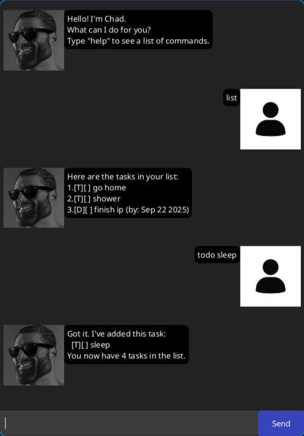

# Chad

Chad is a desktop chatbot that keeps track of your todos, deadlines and events.
You type commands into a chat window, and your tasks are saved automatically.

See the **[User Guide](docs/README.md)** for how to install Chad and use every command.

## Building and running

Prerequisites: JDK 17.

| Task | Command |
|---|---|
| Run the app | `./gradlew run` |
| Build the runnable jar (`build/libs/chad.jar`) | `./gradlew shadowJar` |
| Run the tests | `./gradlew test` |
| Run the tests and the code style checks | `./gradlew check` |

On Windows, use `gradlew.bat` instead of `./gradlew`.

To run the built jar: `java -jar build/libs/chad.jar`. Tasks are saved to `data/data.csv` inside the folder you run
it from.

### Setting up in IntelliJ

1. Open the project folder in IntelliJ (`File` > `Open`) and accept the defaults to import it as a Gradle project.
2. Set the project SDK to **JDK 17** and the language level to `SDK default`
   ([how to](https://www.jetbrains.com/help/idea/sdk.html#set-up-jdk)).
3. Run `chad.gui.Launcher` (in `src/main/java/chad/gui/Launcher.java`).

## Project structure

| Package | Contents |
|---|---|
| `chad` | `Chad`, which runs a parsed command against the task list and save file |
| `chad.gui` | The JavaFX window (`Launcher` is the entry point) |
| `chad.parser` | Turns what the user types into a `Command` |
| `chad.command` | One class per command (`todo`, `deadline`, `event`, `mark`, `find`, ...) |
| `chad.task` | Task types: `TodoTask`, `DeadlineTask`, `EventTask` |
| `chad.tasklist` | The list of tasks |
| `chad.storage` | Loading and saving `data/data.csv` |
| `chad.exception` | Errors shown to the user |

## Acknowledgements

Built from the [SE-EDU Duke project template](https://github.com/se-edu/duke).
