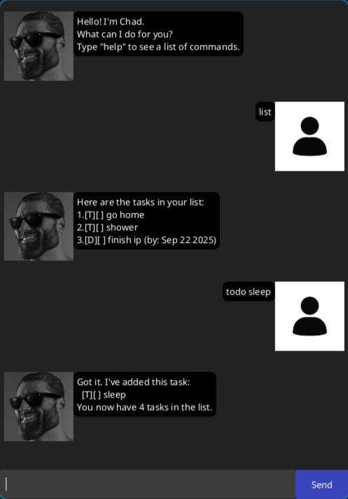

# **Chad** User Guide



# Chad is a chatbot that manages your tasks.

# Getting started
1. Ensure you have Java 17 installed on your computer.
2. Download the latest jar from [<ins>here</ins>](https://github.com/gordontzx/chad/releases).
3. Copy the file to the folder you want to use as the home folder.
4. Open a command terminal, `cd` into the home folder you copied the jar file into, and run the following
command: `java -jar chad.jar` to start the application.

## Where your tasks are saved
Your tasks are saved automatically after every change, in `data/data.csv` inside the folder you run Chad from.
Always start Chad from the same home folder: starting it from a different folder creates a new, empty task list there,
and your saved tasks stay in the original folder. <br/>
If some lines of the save file can't be read (for example, after editing it by hand), Chad skips them, saves a backup
copy of the original file next to it as `data.csv.bak-<date>-<time>`, and tells you when it starts.

# Features

## Viewing help: `help`
Lists out all the available commands. <br/>
Usage: `help` <br/>
Expected output:
```
Here are the commands you can execute:
// list of commands
```

## Listing all tasks: `list`
Lists out all the tasks stored by the user. <br/>
Usage: `list` <br/>
Example output:
```
Here are the tasks in your list:
1.[T][ ] task 1
2.[T][ ] task 2
```

## Finding tasks by keyword: `find`
Finds tasks whose description contains the keyword. Capitals are ignored, so `find BOOK` also matches `book`.<br/>
Usage: `find KEYWORD` <br/>
<br/>
Example: `find book` <br/>
Example output:
```
Here are the matching tasks in your list:
1.[T][ ] borrow book
2.[T][ ] return book
```
If no tasks match, Chad replies `No tasks in your list match "KEYWORD".`

## Adding a todo task: `todo`
Adds a todo type task. <br/>
Usage: `todo TASK_NAME` <br/>
<br/>
Example: `todo borrow book` <br/>
Example output:
```
Got it. I've added this task:
  [T][ ] borrow book
You now have 1 task in the list.
```

## Adding a deadline task: `deadline`
Adds a deadline type task that has a given deadline in YYYY-MM-DD format. <br/>
Usage: `deadline TASK_NAME /by YYYY-MM-DD` <br/>
<br/>
Example: `deadline shower /by 2025-12-31` <br/>
Example output:
```
Got it. I've added this task:
  [D][ ] shower (by: Dec 31 2025)
You now have 2 tasks in the list.
```

## Adding an event task: `event`
Adds an event type task which starts and ends at specified dates, with optional times in 24-hour format.
A date without a time covers the whole day. The end cannot be before the start. <br/>
Usage: `event TASK_NAME /from YYYY-MM-DD [HH:mm] /to YYYY-MM-DD [HH:mm]` <br/>
<br/>
Example: `event meeting /from 2025-12-31 14:00 /to 2025-12-31 15:00` <br/>
Example output:
```
Got it. I've added this task:
  [E][ ] meeting (from: Dec 31 2025 14:00 to: Dec 31 2025 15:00)
You now have 3 tasks in the list.
```

## Marking a task as done: `mark`
Marks a task as done by index. <br/>
Usage: `mark TASK_INDEX` <br/>
<br/>
Example: `mark 1` <br/>
Example output:
```
Nice! I've marked this task as done:
  [T][X] borrow book
```

## Unmarking a task as done: `unmark`
Unmarks a task as done by index. <br/>
Usage: `unmark TASK_INDEX` <br/>
<br/>
Example: `unmark 1` <br/>
Example output:
```
Ok, I've marked this task as not done yet:
  [T][ ] borrow book
```

## Deleting a task: `delete`
Deletes a task by index. <br/>
Usage: `delete TASK_INDEX` <br/>
<br/>
Example: `delete 2` <br/>
Example output:
```
Noted. I've removed the task:
  [D][ ] shower (by: Dec 31 2025)
You now have 2 tasks in the list.
```

## Exiting the app: `bye`
Exits and closes the app. <br/>
Usage: `bye` <br/>
Expected output:
```
bye!
```